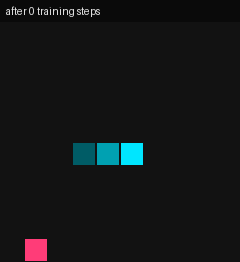

# snake-rl: a hand-written Double DQN that learns Snake



*The same agent on the same game (seed 1000), after 0, 5k, 25k, 100k and 300k training steps.
The episodes were not picked to look good: each checkpoint plays one fixed evaluation seed.*

## Problem
Can a small neural network learn to play Snake from reward alone (+10 for food, -10 for death),
and does it beat a simple hand-coded strategy that sees the same information?

## What is in here
- `src/snakerl/env.py`: a headless Snake game on a 10x10 board, written as a [Gymnasium](https://gymnasium.farama.org/) environment and checked with `check_env`.
  - Actions are relative: straight, turn right, turn left.
  - The snake may move into the cell its tail is leaving.
  - Food only spawns on free cells.
  - An episode is cut off after `100 x length` steps without food. That counts as truncation, so DQN still bootstraps from those steps.
- `src/snakerl/dqn.py`: Double DQN written directly in PyTorch (replay buffer, target network, epsilon-greedy, Huber loss, gradient clipping). It does not use RL libraries.
- `src/snakerl/policies.py`: two baselines.
  - Random.
  - Greedy heuristic: turn toward the food if that move is safe, otherwise take any safe move.
- `src/snakerl/evaluate.py`: evaluation with exploration off, on 200 held-out seeds (1000-1199) that are never used in training. Reports a 95% bootstrap confidence interval.

Observation (11 values): danger straight/right/left, heading, and food up/right/down/left.

## Results (measured, 200 evaluation episodes each)
Three independent training runs (seeds 0, 1, 2), 300,000 steps each, about 6 minutes per run on one CPU thread.

| Policy | Mean food | 95% CI | Median | Max | How episodes ended |
|---|---|---|---|---|---|
| random | 0.17 | 0.12 – 0.23 | 0.0 | 2 | collision: 200 |
| greedy heuristic | 18.21 | 17.45 – 18.98 | 18.0 | 36 | collision: 200 |
| DQN seed0 step 0 | 0.04 | 0.01 – 0.07 | 0.0 | 1 | collision: 200 |
| DQN seed0 step 5,000 | 16.45 | 15.62 – 17.23 | 17.0 | 30 | collision: 165, starved: 35 |
| DQN seed0 step 25,000 | 17.55 | 16.72 – 18.39 | 17.0 | 37 | collision: 200 |
| DQN seed0 step 100,000 | 19.4 | 18.46 – 20.41 | 18.0 | 40 | collision: 200 |
| DQN seed0 step 300,000 | 19.66 | 18.73 – 20.62 | 19.5 | 37 | collision: 200 |
| DQN seed1 step 0 | 0.01 | 0.0 – 0.03 | 0.0 | 1 | starved: 200 |
| DQN seed1 step 5,000 | 11.53 | 10.56 – 12.52 | 11.0 | 32 | starved: 85, collision: 115 |
| DQN seed1 step 25,000 | 17.53 | 16.69 – 18.39 | 17.0 | 41 | collision: 200 |
| DQN seed1 step 100,000 | 19.61 | 18.69 – 20.57 | 19.0 | 38 | collision: 200 |
| DQN seed1 step 300,000 | 19.66 | 18.77 – 20.52 | 19.0 | 38 | collision: 200 |
| DQN seed2 step 0 | 0.04 | 0.01 – 0.07 | 0.0 | 1 | collision: 200 |
| DQN seed2 step 5,000 | 12.43 | 11.37 – 13.41 | 12.0 | 32 | collision: 137, starved: 63 |
| DQN seed2 step 25,000 | 14.99 | 14.12 – 15.81 | 15.0 | 32 | collision: 195, starved: 5 |
| DQN seed2 step 100,000 | 20.42 | 19.46 – 21.41 | 20.0 | 38 | collision: 200 |
| DQN seed2 step 300,000 | 19.43 | 18.54 – 20.43 | 19.0 | 44 | collision: 200 |

What the numbers say:
- The DQN learns quickly. It goes from about 0 to 12-16 food within 5,000 steps.
- All three runs end at a mean of 19.4-19.7 food. The greedy heuristic averages 18.2.
- The DQN wins, but only modestly. All three runs' 95% confidence intervals overlap the heuristic's, so this is a consistent small edge across seeds, not a statistically proven win. A paired test on the same evaluation seeds would settle it.
- Early checkpoints sometimes loop until they are cut off (the "starved" endings). Trained agents stop doing that.

## Run it
```
make setup      # uv sync (CPU PyTorch)
make test       # environment + training smoke tests
make demo       # play the committed checkpoints into demo.gif (no training needed)
make train      # 3 seeds x 300k steps (~6 min each, run in parallel if you like)
make evaluate   # writes results/eval.json
make gif        # rebuilds docs/training.gif
```
The checkpoints in `models/` are about 75 KB each.

## Limitations
- The agent sees only the 3 cells around its head and the direction of the food, not the whole board. It cannot plan around its own body, so every evaluation episode still ends in a collision, usually once the snake fills its own space. A full-grid observation with a CNN is the obvious next step.
- The heuristic shares that blind spot, which is why the gap is small.
- Rewards were not tuned and only one board size (10x10) was tested.
- The results come from 3 training seeds, which is enough to show the gain is consistent but not enough to measure how much training runs vary.

## License
MIT
